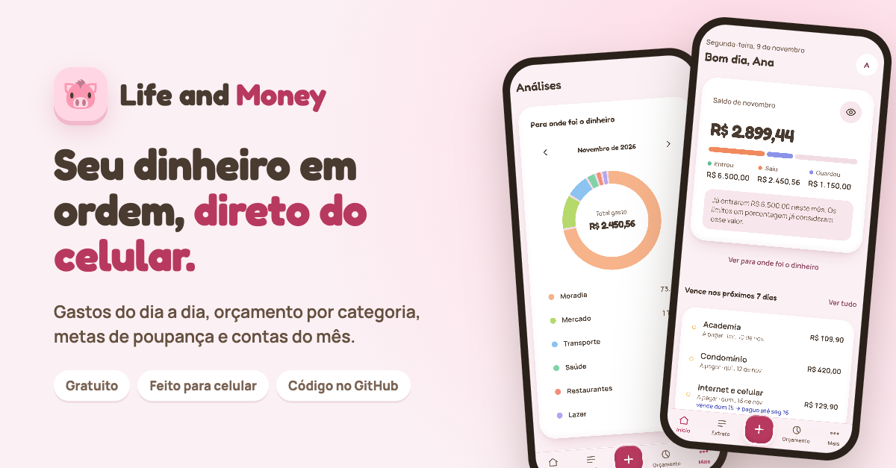
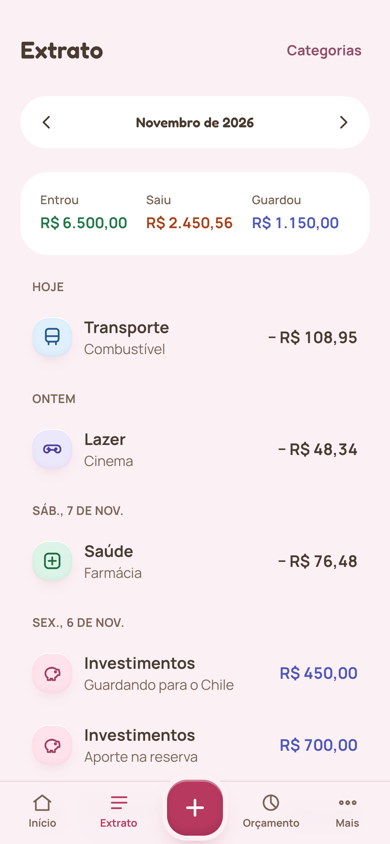
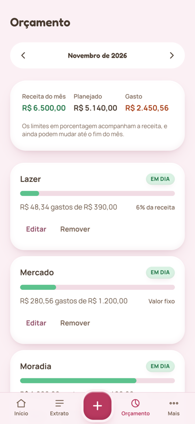
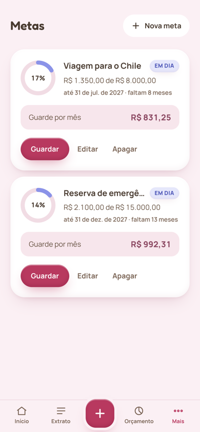
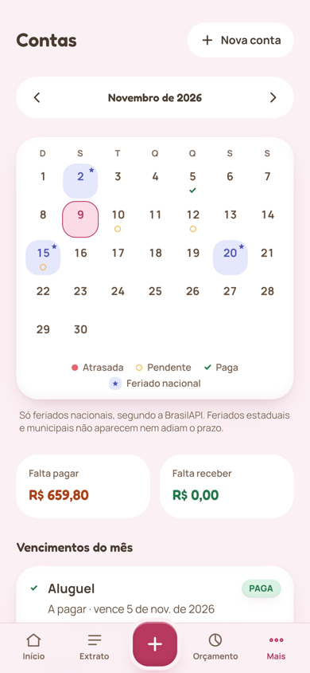
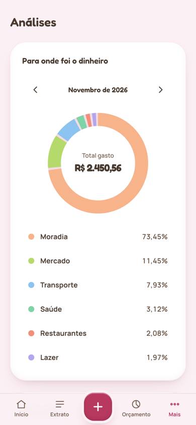
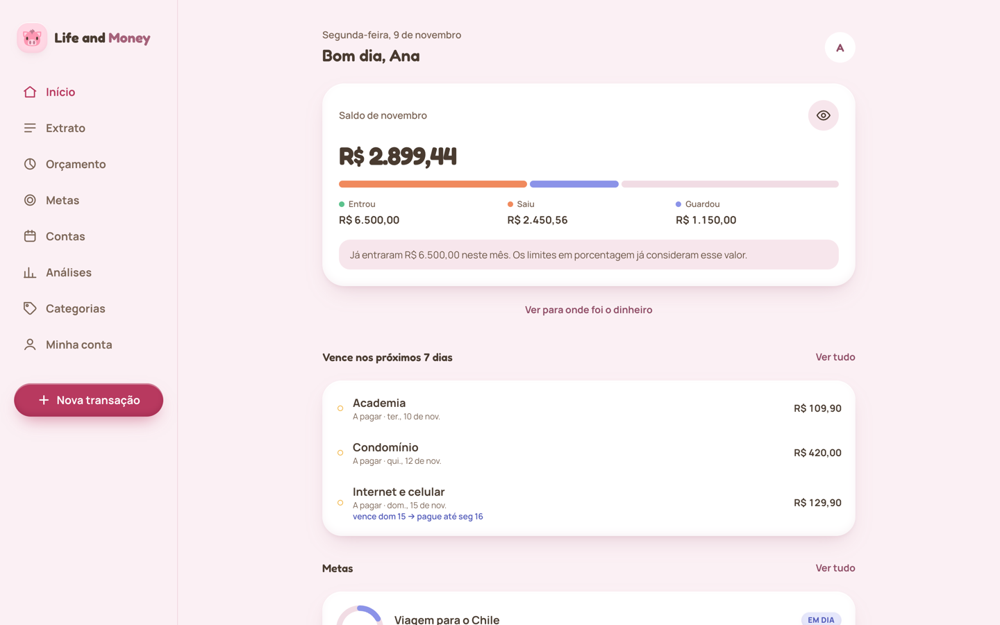

# Life and Money — web

[](https://github.com/akiratochiro/life-and-money-web/actions/workflows/ci.yml)



Front-end for Life and Money, a personal finance app: day-to-day transactions, budgets per
category, savings goals, monthly bills and month-by-month analytics.

It consumes the [Life and Money API](https://github.com/akiratochiro/life-and-money-api), and it
is designed mobile-first: the phone is where an expense gets recorded, right when it happens.

## Try it

**[life-and-money.akira-tochiro23.workers.dev](https://life-and-money.akira-tochiro23.workers.dev)**,
best opened on a phone. Create an account to try it: confirm the email from the link you
receive, and you start with a default set of categories. It is a portfolio project, so feel free to use made-up numbers
([privacy](https://life-and-money.akira-tochiro23.workers.dev/privacy)).

> The API runs on a free instance that sleeps after 15 minutes of inactivity. The first request
> after that can take up to a minute: the app shows a "waking up the server" screen meanwhile.

<table>
  <tr>
    <td align="center"><br><sub>Home</sub></td>
    <td align="center"><br><sub>Statement</sub></td>
    <td align="center"><br><sub>Budget</sub></td>
  </tr>
  <tr>
    <td align="center"><br><sub>Goals</sub></td>
    <td align="center"><br><sub>Bills</sub></td>
    <td align="center"><br><sub>Analytics</sub></td>
  </tr>
</table>



## Highlights

- **Feels like a native app on the phone**: bottom navigation with the "+" in the center,
  full-screen new transaction with a decimal keypad, pull to refresh, swipe to change months, safe
  areas for the notch, and an automated audit that fails on any touch target under 44 px
- **Fast on a free stack**: optimistic updates with rollback, skeletons shaped like the real
  components, prefetch of adjacent months, and a friendly screen while the free API wakes up
- **Security taken seriously**: access token only in memory, refresh token in an `HttpOnly`
  `SameSite=Strict` cookie on the same origin, a strict Content Security Policy, no third-party
  scripts, and rate limits shown as a countdown instead of a generic error
- **Type-safe end to end**: the API client is generated from the back-end's OpenAPI spec, so a
  breaking API change is a compile error here
- **Every decision written down**: [docs/decisions.md](docs/decisions.md) explains the why and the
  trade-offs of each choice, and 200+ tests run on every push

## Screens

| Screen | What it solves |
|---|---|
| Home | A feed ordered by what matters now: the month's balance, what needs attention, goals and budget |
| New transaction | Record an income, an expense or a saving in a few taps, with "today" and "yesterday" shortcuts |
| Statement | The month's transactions grouped by day, with editing and deletion |
| Budget | A limit per category, as a fixed amount or a percentage of income, effective by month |
| Goals | How much is left, how much to save each month and the deadline of each goal |
| Bills | A monthly calendar of what is due, payable and receivable, with overdue, pending and paid markers on each day and national holidays highlighted; mark one as paid (with the real amount) or undo it |
| Analytics | Expenses by category in a donut and month-by-month bars, with the average of closed months |
| Categories | Create, rename and archive your own categories |
| My account | Profile, export all your data as JSON, sign out, and delete the account (typing "EXCLUIR" plus the password) |

## Visual identity

"Cofrinho de argila" (clay piggy bank): claymorphism in pastel tones, with the pig as the symbol.
Light surfaces get their volume from soft pink-tinted shadows and an inner highlight; a single
strong accent (raspberry) is reserved for primary actions and points of attention. Colors are
semantic tokens in Tailwind's `@theme`, and a test checks the WCAG AA contrast of every text and
background pair. Categories have a color and an icon from closed lists defined by the API.

Pig and coin illustrations: [EmojiOne](https://github.com/EmojiTwo/emojitwo) and
[Twemoji](https://github.com/jdecked/twemoji), licensed under
[CC BY 4.0](https://creativecommons.org/licenses/by/4.0/), unmodified.

## On the phone

Below the `md` breakpoint it behaves like a native app: a bottom navigation with a central "+",
safe areas for the notch and the gesture bar, a full-screen new transaction with the amount focused
and a decimal keypad, pull to refresh, swiping sideways to change months, and a short vibration when
a save is confirmed (Android). `npm run audit:mobile` drives an emulated iPhone through every screen
and fails on touch targets under 44 px, inputs under 16 px, horizontal overflow or broken gestures;
[docs/mobile.md](docs/mobile.md) lists what still needs a real device.

## Stack

React 19 · TypeScript · Vite · React Router · TanStack Query · Tailwind CSS 4 · Motion · openapi-fetch + openapi-typescript

## Architecture decisions

The main ones are in [docs/decisions.md](docs/decisions.md), and [docs/revisao.md](docs/revisao.md)
covers the same choices as questions and answers. In short:

- **Types generated from the API's OpenAPI spec**, never written by hand: the back-end contract is
  the source of truth, and a breaking change shows up as a compile error
- **Organized by feature** (`features/transactions`, `features/budget`...), with shared code in `shared/`
- **TanStack Query owns server state**; there is no global store for server data
- **Money as integer cents** in forms, so values are never rounded wrong before being sent
- **Errors come ready from the API** (RFC 9457): the `detail` arrives in Portuguese and goes straight to the screen
- **The access token lives only in memory**; after a reload, the session comes back through an
  `HttpOnly` cookie that this code never reads
- **Front and API on the same origin**: the Worker that serves the front proxies `/api/*` to the
  API, so the session cookie is not a third-party cookie and Safari does not block it
- **The password reset token never lingers**: `/reset-password` reads the token from the emailed
  link into memory and removes it from the URL right away, and the whole app sends no `Referer`
  (`<meta name="referrer" content="no-referrer">`)
- **Rate limits are shown, not hidden**: when the API answers `429`, login, sign-up and password
  reset show a countdown and keep the button disabled until it ends; the Worker forwards the
  user's real IP to the API, signed with a shared secret, so users never share one limit
- **The bills calendar is a CSS grid, with no calendar library**: seven columns, the first day placed with
  `grid-column-start`, and dates handled as `YYYY-MM-DD` text built with the local `Date` constructor,
  so a bill due on the 28th never shows up on the 27th because of UTC. Status uses shape as well as
  color, and the home screen shows what is overdue or due in the next 7 days
- **National holidays shape the deadline, not just the calendar**: holiday days are highlighted
  (from the [BrasilAPI](https://brasilapi.com.br), through the API), and a bill due on a weekend or
  holiday shows "vence sáb 14 → pague até seg 16". The deadline comes ready from the API, so the
  front never has a second rule for "is it overdue?". State and municipal holidays are not covered,
  and the screen says so
- **Optimistic updates with rollback**: creating, editing and deleting a transaction, contributing to
  a goal and archiving a category change the screen before the server answers; if it refuses, the
  cache snapshot comes back and a toast says why. What each mutation reloads lives in a single map,
  tested line by line
- **Fluid, but light**: skeletons shaped like the real components, a spinner inside buttons that
  keeps their width, prefetch of the previous and next month, and short transitions (150 to
  250 ms) with [Motion](https://motion.dev) through `LazyMotion`, respecting `prefers-reduced-motion`
- **A sleeping API does not look like an error**: the free Render instance hibernates, so the app
  checks `/api/health` on start and, if it takes more than about 2 seconds, shows a "waking up the
  server" screen until the API answers. Queries retry only transient failures (network, timeout,
  502/503/504); writes never retry, so a transaction is never saved twice

## Running locally

Requirements: Node 22.22+ or 24.15+ (required by jsdom, used in the tests) and the API running at
`http://localhost:8081`.

```bash
git clone https://github.com/akiratochiro/life-and-money-web.git
cd life-and-money-web
npm install
npm run dev
```

The app runs at `http://localhost:5173`. The Vite proxy forwards `/api/*` to `localhost:8081`, so
the browser only talks to the front's origin, as in production. There is no environment variable
to set.

## Scripts

| Script | What it does |
|---|---|
| `npm run dev` | Development server with HMR |
| `npm run build` | Type-checks (`tsc -b`) and builds the production bundle |
| `npm run preview` | Serves the built bundle, to check the build |
| `npm run lint` | Runs ESLint on the whole project |
| `npm test` | Runs the tests once (Vitest + Testing Library on jsdom) |
| `npm run test:watch` | Runs the tests in watch mode, re-running on every change |
| `npm run api:types` | Regenerates `src/shared/api/schema.d.ts` from the API's OpenAPI spec |

Whenever an endpoint or a field changes in the API, run `npm run api:types` with the API running
and commit the generated file together with the change that uses it.

## Tests

```bash
npm test
```

Tests live next to the code they cover (`money.ts` → `money.test.ts`) and run on Vitest, which
reuses the Vite configuration. Pure functions, such as the cents conversion and the order of the
budget alerts, have unit tests; components are tested with Testing Library, which interacts with
them the way a user would, on a DOM simulated by jsdom. CI runs the tests on every push, before
the build.

## Deployment

The front is deployed as a **Cloudflare Worker** that does two things:

- serves the static files in `dist`, straight from the assets layer;
- proxies `/api/*` to the API on Render ([`worker/index.ts`](worker/index.ts)), without rewriting
  the path. Only those requests run the Worker script.

| Setting | Value |
|---|---|
| Build command | `npm run build` |
| Deploy command | `npx wrangler deploy` |

There is no build variable. The API address is `vars.API_ORIGIN` in [`wrangler.jsonc`](wrangler.jsonc),
without a trailing slash, and it is read at runtime: pointing the front at another API only needs
a new `wrangler deploy`, not a new build.

To try the Worker locally against the local API, create a `.dev.vars` file (ignored by git) with
`API_ORIGIN=http://localhost:8081` and run `npm run build && npx wrangler dev`.

Routing is handled by [`wrangler.jsonc`](wrangler.jsonc): `not_found_handling: "single-page-application"`
serves `index.html` for any path that is not a file, so that opening `/goals` directly, or
reloading it, reaches React Router instead of returning a 404.

The full step by step, including the API and the database, is in the
[API's docs/deploy.md](https://github.com/akiratochiro/life-and-money-api/blob/main/docs/deploy.md).

## Roadmap

- Installable as a PWA, with a home-screen shortcut
- Withdrawals from savings goals (depends on the API)
- Keyboard arrow navigation in the bills calendar
